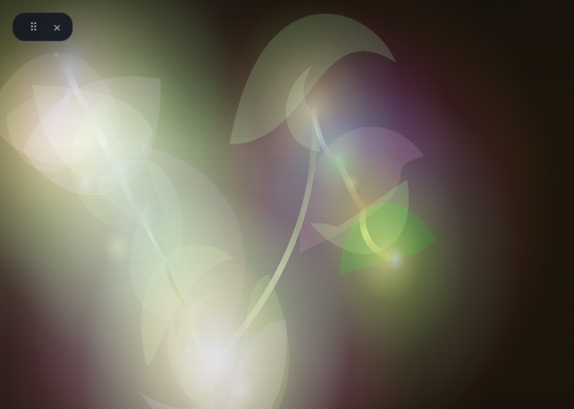
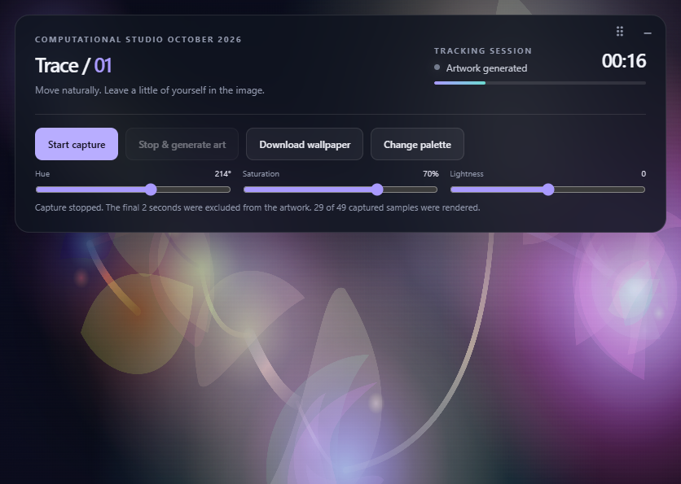

# Trace -- Computational Studio October 2026

A self-contained mouse-tracking artwork generator built with vanilla JavaScript, HTML5 canvas, and CSS. No build step, server, or external dependencies are required.

## Screenshots

The generated artwork fills the canvas, and the control panel minimizes when rendering is complete:



Expand the panel to start another capture, adjust the palette, or download the wallpaper:



## Run

Open `index.html` in a modern desktop browser. The page loads its styles and behavior from the `source` folder.

## Use

1. Select **Start capture** and choose a starting point during the five-second countdown.
2. Move the pointer during the 20-second capture; the captured path informs the final artwork.
3. Select **Stop & generate art** to finish early, or let the capture finish automatically.
4. Adjust the palette with the sliders or select **Change palette**. Slider changes apply when released.
5. Select **Download wallpaper** to save the 3840 × 2160 PNG.

Drag the handle to reposition the control panel. Use the adjacent toggle to minimize or expand it; the panel minimizes automatically after rendering. Generated forms and curves vary in rotation, scale, and direction.

## Project structure

```text
index.html
source/
  script.js
  style.css
screenshots/
  artwork.png
  controls.png
```
